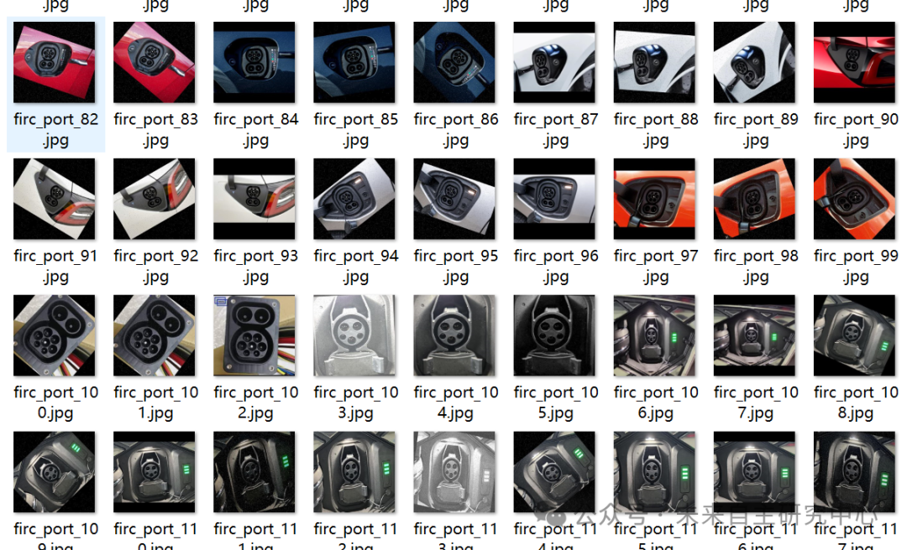
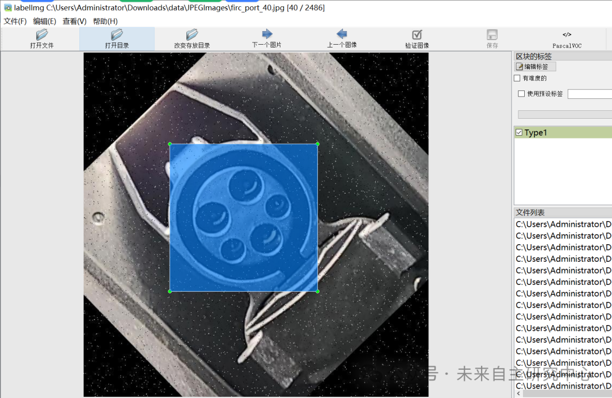

# Vehicle Occupant Comfort and Safety Evaluation Data Set (VOC+YOLO format, 2486 images in 3 categories)

The dataset has been enhanced, with more than 1/4 being original images and the rest being enhanced.

Dataset format: Pascal VOC format + YOLO format (txt file without split path, only containing jpg images and corresponding VOC format xml files and yolo format txt files)

Number of images (number of jpg files): 2486

Number of annotations (number of xml files): 2486

Number of annotations (number of txt files): 2486

Label category count: 3

Label category names (note that the order of yolo format categories does not correspond to this, but is based on the labels folder's classes.txt): ["CCS2_Type2", "Type1", "charging-pocket"]

Number of boxes labeled in each category:

CCS2_Type2 Frame Count = 920

Type1 Frame Count = 837

Charging-pocket frame count = 729

Total frame count: 2486

Using labelImg:

Annotation rules: Draw a rectangle around the category.

Important Notice: No

Special : This dataset does not guarantee the accuracy or precision of the trained models or weight files. The dataset is provided with accurate and reasonable annotations only.

Image Preview:

Annotation example:

## Payment

Here is a pay link on Stripe ( https://buy.stripe.com/3cs8yP7sY87d0vu9AB ). Please contact me lonlonago@foxmail.com after funding $89, and I will send you a complete data files , thank you!

